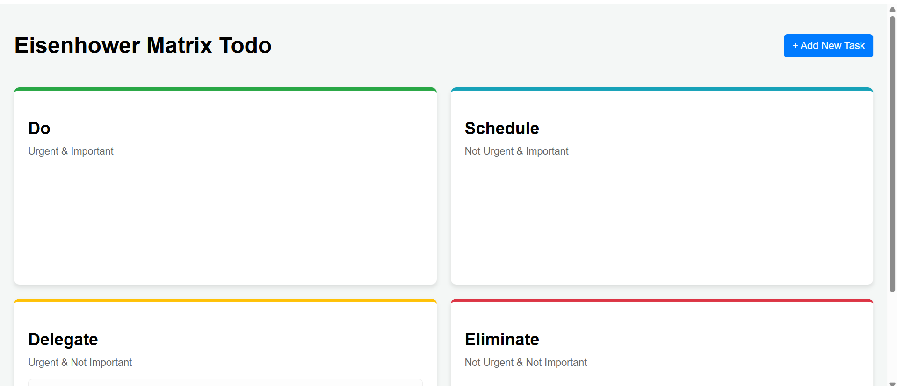

# ✅ Eisenhower Matrix Todo Application

A **server-side rendered task management application** built with **Node.js, Express.js, EJS, and MongoDB** that helps users organize tasks according to the **Eisenhower Matrix**.

Instead of maintaining a simple Todo list, the application classifies every task based on **urgency** and **importance**, automatically placing it into one of four productivity quadrants: **Do, Schedule, Delegate, or Eliminate**.

> Developed as part of the **Backend Development Lab Examination — Exam01B**.

---

## 📌 Overview

The **Eisenhower Matrix Todo Application** demonstrates how backend technologies can be combined to build a complete database-driven web application.

Users can:

- Create tasks
- Add descriptions
- Specify whether a task is urgent
- Specify whether a task is important
- Automatically categorize tasks
- Mark tasks as completed
- Restore completed tasks
- Delete tasks
- Persist task data in MongoDB

The interface is rendered on the server using **EJS**, while **Express.js** handles application routing and **MongoDB** provides persistent storage.

---

## 🎯 Eisenhower Matrix

The Eisenhower Matrix is a task-prioritization technique that organizes work according to two properties:

**Urgency** — Does the task require immediate attention?

**Importance** — Does the task contribute to an important objective?

Combining these properties creates four quadrants:

| Quadrant | Urgent | Important | Action |
|---|:---:|:---:|---|
| 🔴 **Do** | ✅ | ✅ | Complete immediately |
| 🟢 **Schedule** | ❌ | ✅ | Plan for later |
| 🟡 **Delegate** | ✅ | ❌ | Delegate or handle accordingly |
| ⚪ **Eliminate** | ❌ | ❌ | Remove or minimize |

The application automatically determines the correct quadrant from the values selected when a task is created.

---

## ✨ Features

### 🗂️ 1. Four-Quadrant Dashboard

The homepage displays tasks using a **2 × 2 Eisenhower Matrix**:

```text
┌──────────────────────────┬──────────────────────────┐
│           DO             │        SCHEDULE          │
│                          │                          │
│    Urgent + Important    │  Not Urgent + Important │
├──────────────────────────┼──────────────────────────┤
│        DELEGATE          │        ELIMINATE         │
│                          │                          │
│  Urgent + Not Important  │ Not Urgent +             │
│                          │     Not Important        │
└──────────────────────────┴──────────────────────────┘
```

Tasks retrieved from MongoDB are filtered into their corresponding quadrant before the page is rendered.

---

### ➕ 2. Create Tasks

Users can add a new task using a dedicated form.

Each task supports:

- **Title**
- **Description**
- **Urgent / Not Urgent**
- **Important / Not Important**

The server validates the title before inserting the task into MongoDB.

---

### 🧠 3. Automatic Task Classification

Users do not manually select a quadrant.

Instead, the backend determines the category from the `isUrgent` and `isImportant` properties:

```javascript
const matrix = {
    doTasks: tasks.filter(t => t.isUrgent && t.isImportant),
    scheduleTasks: tasks.filter(t => !t.isUrgent && t.isImportant),
    delegateTasks: tasks.filter(t => t.isUrgent && !t.isImportant),
    eliminateTasks: tasks.filter(t => !t.isUrgent && !t.isImportant)
};
```

This keeps the prioritization logic centralized in the application.

---

### ✅ 4. Complete Tasks

Tasks can be marked as completed directly from the matrix using a checkbox.

The backend updates:

```text
isCompleted: false
        ↓
isCompleted: true
```

Completed tasks remain stored in MongoDB and are visually distinguished in the interface.

---

### 🔄 5. Redo Completed Tasks

A completed task does not have to be recreated.

The **Redo** functionality changes:

```text
isCompleted: true
        ↓
isCompleted: false
```

This restores the task to its active state while keeping its original quadrant.

---

### 🗑️ 6. Delete Tasks

Tasks can be permanently removed from the application.

MongoDB's document `_id` is converted to an `ObjectId` and used to locate the correct task:

```javascript
await tasksCollection.deleteOne({
    _id: new ObjectId(req.params.id)
});
```

---

### 💾 7. Persistent Storage

Tasks are stored in a local **MongoDB database**, so they remain available after restarting the Express application.

Database:

```text
todo_lab
```

Collection:

```text
tasks
```

---

## 🛠️ Tech Stack

### Backend


- **Node.js** — JavaScript runtime
- **Express.js** — Web server and routing
- **MongoDB Native Driver** — Database communication

### Database


- MongoDB
- `MongoClient`
- `ObjectId`

### Frontend / Rendering


- EJS
- HTML5
- CSS3
- CSS Grid
- Flexbox

---

## 🏗️ Application Architecture

```text
                         USER
                           │
                           ▼
                    ┌─────────────┐
                    │   Browser   │
                    └──────┬──────┘
                           │
                     HTTP Request
                           │
                           ▼
                 ┌───────────────────┐
                 │   Express.js      │
                 │     Server        │
                 └─────────┬─────────┘
                           │
             ┌─────────────┴─────────────┐
             │                           │
             ▼                           ▼
     ┌──────────────┐            ┌──────────────┐
     │    Routes    │            │     EJS      │
     │              │            │    Views     │
     └──────┬───────┘            └──────────────┘
            │
            ▼
     ┌──────────────┐
     │   MongoDB    │
     │              │
     │ todo_lab     │
     │   └─ tasks   │
     └──────────────┘
```

The application follows a simple server-side rendered architecture:

1. The browser sends an HTTP request.
2. Express receives and processes the request.
3. MongoDB is queried or updated when necessary.
4. Data is passed to an EJS template.
5. EJS generates the HTML.
6. Express returns the rendered page to the browser.

---

## 📁 Project Structure

```text
Exam01B/
│
├── app.js
│   ├── Express server configuration
│   ├── MongoDB connection
│   ├── Eisenhower classification
│   └── Application routes
│
├── package.json
├── package-lock.json
│
├── public/
│   └── style.css
│       ├── Matrix layout
│       ├── Task cards
│       ├── Buttons
│       └── Form styling
│
├── views/
│   ├── index.ejs
│   │   └── Eisenhower Matrix dashboard
│   │
│   └── new.ejs
│       └── Add-task form
│
└── README.md
```

---

## 🗄️ Task Document Structure

A newly created task is stored in MongoDB with the following structure:

```javascript
{
    _id: ObjectId,
    title: String,
    description: String,
    isUrgent: Boolean,
    isImportant: Boolean,
    isCompleted: Boolean,
    createdAt: Date
}
```

### Example

```javascript
{
    "_id": ObjectId("..."),
    "title": "Complete Backend Assignment",
    "description": "Finish and submit the backend lab work",
    "isUrgent": true,
    "isImportant": true,
    "isCompleted": false,
    "createdAt": ISODate("...")
}
```

Since the example task is both **urgent and important**, it appears automatically in the **Do** quadrant.

---

## 🌐 Application Routes

| Method | Route | Purpose |
|---|---|---|
| `GET` | `/` | Retrieve tasks and display the Eisenhower Matrix |
| `GET` | `/tasks/new` | Display the new-task form |
| `POST` | `/tasks` | Create and store a new task |
| `POST` | `/tasks/:id/complete` | Mark a task as completed |
| `POST` | `/tasks/:id/redo` | Restore a completed task |
| `POST` | `/tasks/:id/delete` | Delete a task |

---

## 🔄 Application Workflow

```text
                    Start Application
                           │
                           ▼
                   Connect to MongoDB
                           │
                           ▼
                    Load Dashboard
                           │
                           ▼
                  Retrieve All Tasks
                           │
                           ▼
             ┌──── Classify Tasks ────┐
             │                        │
             ▼                        ▼
      Urgent / Important      Not Urgent / Important
             │                        │
             ▼                        ▼
            DO                    SCHEDULE

      Urgent / Not Important  Not Urgent / Not Important
             │                        │
             ▼                        ▼
         DELEGATE                 ELIMINATE
             │                        │
             └────────────┬───────────┘
                          ▼
                    Render with EJS
                          │
                          ▼
                 Display in Browser
```

---

## 🚀 Installation & Setup

### Prerequisites

Make sure the following are installed:

- **Node.js**
- **npm**
- **MongoDB**

---

### 1. Clone the Repository

```bash
git clone https://github.com/ritkritig/BackendDevelopment.git
```

Navigate to the project:

```bash
cd "BackendDevelopment/Backend Lab/Exam01B"
```

---

### 2. Install Dependencies

```bash
npm install
```

The project uses:

```text
express
ejs
mongodb
```

---

### 3. Start MongoDB

The application expects MongoDB at:

```text
mongodb://127.0.0.1:27017
```

Make sure your local MongoDB server is running before starting the application.

The application automatically uses:

```text
Database   : todo_lab
Collection : tasks
```

---

### 4. Start the Application

```bash
node app.js
```

The terminal should display:

```text
Connected to Local MongoDB
Server running at http://localhost:3000
```

---

### 5. Open the Application

Open:

```text
http://localhost:3000
```

in your browser.

---

## 🔍 Backend Concepts Demonstrated

This project brings together several important backend development concepts:

- Express server creation
- HTTP request/response cycle
- GET and POST routes
- Route parameters
- Form-data processing
- Server-side rendering
- EJS templates
- Static-file serving
- MongoDB connectivity
- Persistent data storage
- CRUD-style database operations
- MongoDB `ObjectId`
- Asynchronous JavaScript
- `async/await`
- Input validation
- Error handling
- Redirects
- Business-logic implementation

---

## 💡 Key Implementation Details

### Form Processing

Express middleware processes URL-encoded form submissions:

```javascript
app.use(express.urlencoded({ extended: true }));
```

### Static Files

CSS is served from the `public` directory:

```javascript
app.use(express.static("public"));
```

### Server-Side Rendering

EJS is configured as the application's view engine:

```javascript
app.set("view engine", "ejs");
```

### Database Connection

MongoDB is accessed through the native MongoDB Node.js driver:

```javascript
const { MongoClient, ObjectId } = require("mongodb");

const mongoURL = "mongodb://127.0.0.1:27017";
const client = new MongoClient(mongoURL);
```

### Asynchronous Database Operations

Database operations use `async/await`:

```javascript
const tasks = await tasksCollection.find().toArray();
```

This keeps asynchronous database operations readable and easy to follow.

---

## 🎓 Learning Outcomes

Through this project, I practiced how to:

- Build a complete backend application using Express.js
- Connect a Node.js application to MongoDB
- Store and retrieve persistent data
- Process HTML form submissions
- Implement server-side rendering using EJS
- Perform create, read, update, and delete operations
- Use MongoDB document IDs in application routes
- Implement application-specific business logic
- Organize data dynamically before rendering it
- Handle asynchronous database operations
- Implement basic validation and error handling
- Structure a small full-stack web application

---

## 📖 Project Context

**Course:** Backend Development Lab  
**Assessment:** Exam01B  
**Project:** Eisenhower Matrix Todo Application

This project demonstrates the integration of **Node.js, Express.js, EJS, MongoDB, HTML, and CSS** to create a functional server-side rendered task-management application with persistent storage and meaningful backend logic.

---
## 📸 Final Outcome



## 👩‍💻 Author

**Ritkriti Goyal**

Backend Development Lab Project
