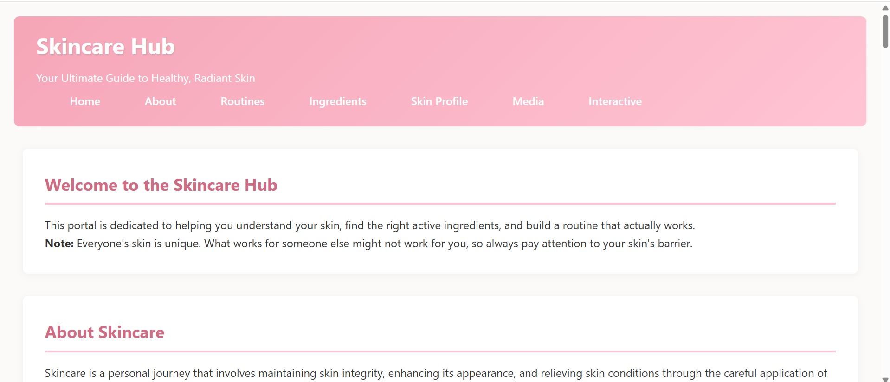

# 🧴 Experiment 1 — Skincare Hub | HTML5 Web Page

A comprehensive **HTML5 web page** developed as part of the **Backend Development Lab** to demonstrate the practical use of modern HTML5 elements, semantic page structure, forms, tables, multimedia, and interactive components.

The project uses a **Skincare Hub** as the theme, presenting skincare information while demonstrating how different HTML5 elements can be combined to create a structured, accessible, and interactive webpage.

---

## 📌 Experiment

**Experiment 1: Create a Web Page Using HTML5 Elements**

### Course Outcome

**CO2:** Create and build web pages and applications.

---

## 🎯 Objective

The objective of this experiment is to understand and implement the major features introduced in HTML5 by building a complete webpage.

The experiment focuses on:

- Creating a structured HTML5 document
- Using semantic HTML elements
- Working with text formatting and lists
- Creating structured tables
- Designing HTML5 forms
- Using advanced input types
- Embedding images, audio, and video
- Implementing progress and meter indicators
- Using interactive HTML5 elements
- Understanding basic accessibility and semantic webpage design

---

# 🌿 Project Overview — Skincare Hub

**Skincare Hub** is an informational webpage designed around skincare routines, ingredients, and skin profiles.

The page contains multiple sections that demonstrate different HTML5 features while maintaining a consistent skincare theme.

### Main Sections

```text
Skincare Hub
│
├── Home
├── About Skincare
├── Building Your Routine
├── Ingredient Comparison
├── Create Your Skin Profile
├── Multimedia Content
└── Interactive Elements
```

---

## ✨ Features Implemented

### 🏗️ 1. Semantic HTML5 Structure

The webpage uses semantic elements to clearly define different parts of the document.

```html
<header>
<nav>
<main>
<section>
<article>
<footer>
```

Using semantic elements improves the organization and readability of the HTML document while also supporting accessibility and search-engine understanding.

---

### 📝 2. Text Formatting

Different HTML formatting elements are demonstrated throughout the webpage.

Examples include:

```html
<strong>
<em>
<mark>
<del>
<ins>
<code>
<kbd>
<abbr>
<address>
```

These elements provide semantic meaning in addition to visual formatting.

---

### 📋 3. Lists

Different types of HTML lists are implemented to organize skincare information.

The experiment demonstrates:

- Unordered lists
- Ordered lists
- Nested lists
- Description lists

```html
<ul>
<ol>
<dl>
<dt>
<dd>
```

These are used to present concepts such as skincare routines and ingredient information in an organized manner.

---

## 🧴 4. Skincare Routine Section

The webpage contains a dedicated section explaining how a skincare routine can be structured.

It includes information such as:

- Basic skincare concepts
- Morning skincare routine
- Skincare ingredients
- Their common uses

This section demonstrates how headings, paragraphs, lists, and formatted content can be combined to create a structured informational page.

---

## 📊 5. Ingredient Comparison Table

A structured HTML table is used to compare skincare ingredients.

The implementation demonstrates:

```html
<table>
<caption>
<thead>
<tbody>
<tfoot>
<tr>
<th>
<td>
```

The table also includes styling for improved readability and presentation.

This demonstrates how structured tabular data can be represented using semantic HTML.

---

## 📝 6. Skin Profile Form

The **Create Your Skin Profile** section demonstrates one of the major features of HTML5 — advanced forms.

The form includes several input types and controls.

### Input Types Demonstrated

```text
Text
Email
Telephone
Number
Date
Color
Range
File
URL
Radio Buttons
Checkboxes
Select Menu
Textarea
Buttons
```

HTML elements such as the following are also used:

```html
<form>
<fieldset>
<legend>
<label>
<select>
<textarea>
<button>
```

This demonstrates how HTML5 can collect different types of structured user input.

---

## 🎚️ 7. Interactive Form Controls

The project also demonstrates interactive form behaviour.

A range slider provides real-time feedback using JavaScript.

This introduces the connection between:

```text
HTML Elements
      ↓
User Interaction
      ↓
JavaScript Event
      ↓
Updated Webpage
```

---

## 🖼️ 8. Responsive Images

The webpage demonstrates modern HTML5 image handling using:

```html
<picture>
<source>
<figure>
<figcaption>
```

These elements allow images to adapt to different conditions while providing meaningful captions and structure.

---

# 🎵 9. Multimedia

HTML5 provides native support for multimedia without requiring external browser plugins.

The **Multimedia Content** section demonstrates both audio and video.

### Audio

```html
<audio controls>
```

An audio element is used to represent a skincare podcast excerpt.

### Video

```html
<video controls>
```

A video section demonstrates skincare-related visual content.

The implementation also explores multiple media sources and the HTML5 `<track>` element.

---

## 📈 10. Progress & Meter Elements

The experiment demonstrates two useful HTML5 indicators.

### Progress

```html
<progress value="30" max="100">
```

Used to represent the progress of an operation.

### Meter

```html
<meter value="8.5" min="0" max="10">
```

Used to represent a measurement within a known range.

These elements demonstrate how HTML5 can represent values without creating custom components.

---

# ⚡ 11. Interactive HTML5 Elements

The webpage includes several native interactive HTML elements.

### Details & Summary

```html
<details>
    <summary>...</summary>
</details>
```

These provide expandable and collapsible content without requiring a custom component.

---

### Datalist

The ingredient search feature uses:

```html
<datalist>
```

This provides predefined suggestions while the user types.

---

### Dialog

A native HTML dialog is implemented using:

```html
<dialog>
```

JavaScript controls the dialog using methods such as:

```javascript
showModal()
close()
```

This demonstrates how HTML5 can provide built-in modal functionality.

---

# 🛠️ Technologies Used


| Technology | Purpose |
|---|---|
| **HTML5** | Webpage structure and content |
| **CSS3** | Styling and visual presentation |
| **JavaScript** | Basic interaction and dynamic behaviour |
| **VS Code** | Development environment |
| **Browser DevTools** | Testing and debugging |

---

# 📁 Project Structure

```text
Experiment1/
│
├── index.html
├── images/
│   └── screenshot.png
│
└── README.md
```

> The `images` folder can be added to store the final output screenshot used in this README.

---

# ▶️ How to Run

### Method 1 — Directly in Browser

Open:

```text
index.html
```

in any modern web browser.

### Method 2 — VS Code Live Server

1. Open the `Experiment1` folder in **Visual Studio Code**.
2. Install the **Live Server** extension if required.
3. Right-click `index.html`.
4. Select **Open with Live Server**.

The webpage will open automatically in your browser.

---

# 📸 Final Output

The final webpage combines semantic HTML5 structure, skincare information, tables, forms, multimedia, and interactive elements into a single webpage.

<p align="center">
  
</p>

<p align="center">
  <i>Final output of the Skincare Hub HTML5 webpage.</i>
</p>

---

# 🧠 HTML5 Concepts Demonstrated

This experiment provides hands-on practice with:

- HTML5 document structure
- Semantic HTML
- Navigation
- Headings and paragraphs
- Text formatting
- Lists
- Tables
- Forms
- HTML5 input types
- Form controls
- Images and figures
- Audio
- Video
- Progress indicators
- Meter elements
- Details and summary
- Datalist
- Dialog boxes
- Basic JavaScript interaction
- Accessible webpage structure
- Responsive content

---

# 🎓 Learning Outcomes

After completing this experiment, I was able to:

- Create a complete HTML5 webpage from scratch
- Structure webpages using semantic HTML elements
- Organize information using lists and tables
- Design forms using different HTML5 input types
- Embed multimedia content directly in a webpage
- Use native HTML5 interactive elements
- Understand the purpose of semantic HTML
- Apply basic CSS styling to improve presentation
- Add simple JavaScript interactions
- Build a structured and user-friendly webpage

---

## 📚 Course Information

**Course:** Backend Development Lab  
**Experiment:** 1  
**Topic:** HTML5 Elements and Web Page Development  
**Project:** Skincare Hub

---

## 👩‍💻 Author

**Ritkriti Goyal**

Backend Development Lab — Experiment 1
