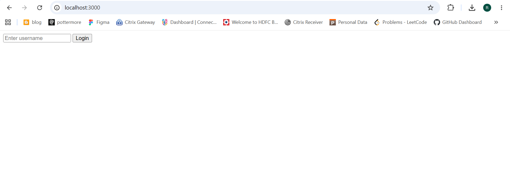

# 🍪 Experiment 12B — Cookies & Sessions in Express.js

A practical backend development experiment demonstrating **state management in web applications using Cookies and Sessions with Node.js and Express.js**.

The experiment explores how a server can remember information across multiple HTTP requests, including **setting, retrieving and deleting cookies, tracking visits through sessions, maintaining login state, and destroying sessions during logout**.

---

## 📌 Experiment

**Experiment 12B: Cookies and Session Management using Express.js**

### Technologies Used


---

# 🎯 Objective

The objective of this experiment is to understand how **cookies and sessions maintain state in otherwise stateless HTTP applications**.

The experiment demonstrates how to:

- Create cookies
- Read cookies from incoming requests
- Delete cookies
- Configure cookie expiration
- Create Express sessions
- Store information in a session
- Access session data across requests
- Track the number of visits
- Destroy sessions
- Maintain a simple login state
- Implement logout functionality
- Use cookies and sessions together

---

# 🧠 Why Are Cookies & Sessions Needed?

HTTP is fundamentally **stateless**.

This means that every request is treated independently:

```text
Request 1 ──────► Server
Request 2 ──────► Server
Request 3 ──────► Server
```

By default, the server does not automatically remember information from previous requests.

Cookies and sessions provide mechanisms for maintaining state:

```text
                 USER
                   │
                   ▼
               Browser
                   │
            Cookie / Session ID
                   │
                   ▼
             Express Server
                   │
                   ▼
            Session Information
                   │
                   ▼
          Personalized Response
```

---

# 📂 Experiment Components

The experiment contains three implementations:

```text
Experiment12B/
│
├── source/
│   ├── cookie-example.js
│   └── session-example.js
│
├── session-cookie-demo/
│   └── server.js
│
├── package.json
├── package-lock.json
│
├── Images/
│   └── screenshot.png
│
└── README.md
```

### `cookie-example.js`

Demonstrates basic cookie operations:

**Set → Retrieve → Delete**

### `session-example.js`

Demonstrates session-based visit tracking and session destruction.

### `session-cookie-demo/server.js`

Combines cookies and sessions to implement a simple **login/logout workflow**.

---

# 🍪 Part 1 — Cookie Management

The first implementation demonstrates how cookies can be managed using Express and `cookie-parser`.

The required package is imported using:

```javascript
const cookieParser = require('cookie-parser');
```

and configured as middleware:

```javascript
app.use(cookieParser());
```

---

## ➕ Setting a Cookie

The following route creates a cookie:

```text
GET /set-cookie
```

The application stores:

```text
username = JohnDoe
```

using:

```javascript
res.cookie('username', 'JohnDoe', {
    maxAge: 900000
});
```

The `maxAge` property determines how long the cookie remains valid.

### Flow

```text
GET /set-cookie
       │
       ▼
Express Server
       │
       ▼
Create username Cookie
       │
       ▼
Browser Stores Cookie
```

---

# 🔍 Retrieving a Cookie

The cookie can be retrieved using:

```text
GET /get-cookie
```

The application accesses:

```javascript
req.cookies['username']
```

and returns the stored value.

### Flow

```text
Browser
   │
   │ username=JohnDoe
   ▼
Express Server
   │
   ▼
req.cookies
   │
   ▼
Retrieve username
   │
   ▼
Cookie Retrieved: JohnDoe
```

---

# 🗑️ Deleting a Cookie

The cookie can be removed through:

```text
GET /delete-cookie
```

using:

```javascript
res.clearCookie('username');
```

The server then responds with:

```text
Cookie deleted
```

---

# 🔄 Cookie Lifecycle

The complete cookie workflow demonstrated in the experiment is:

```text
SET COOKIE
    │
    ▼
username = JohnDoe
    │
    ▼
Browser Stores Cookie
    │
    ▼
GET COOKIE
    │
    ▼
Retrieve username
    │
    ▼
DELETE COOKIE
    │
    ▼
Cookie Removed
```

---

# 💾 Part 2 — Express Sessions

The second implementation demonstrates server-side state management using **`express-session`**.

The middleware is configured as:

```javascript
app.use(session({
    secret: 'mysecretkey',
    resave: false,
    saveUninitialized: true
}));
```

---

## 👁️ Session-Based Visit Counter

The application uses:

```javascript
req.session.views
```

to remember how many times a user has visited the page during the session.

On the first visit:

```text
Welcome to the session demo.
Refresh to count visits.
```

The session stores:

```javascript
req.session.views = 1;
```

When the page is refreshed:

```javascript
req.session.views++;
```

The response becomes similar to:

```text
Welcome back! You visited 2 times.
```

Further requests continue increasing the counter.

---

# 🔄 Session Visit Flow

```text
First Request
     │
     ▼
Session Created
     │
     ▼
views = 1
     │
     ▼
Refresh Page
     │
     ▼
Existing Session Found
     │
     ▼
views++
     │
     ▼
Display Visit Count
```

This demonstrates how a session can preserve data between HTTP requests.

---

# 💥 Destroying a Session

The session example provides:

```text
GET /destroy
```

The session is removed using:

```javascript
req.session.destroy(...)
```

After the session is destroyed, the stored visit counter is no longer available.

A new visit starts a new session.

---

# 🔐 Part 3 — Cookie + Session Login Demo

The `session-cookie-demo` combines both concepts into a simple authentication-style workflow.

It demonstrates:

- Login form processing
- Session creation
- Username storage
- Cookie creation
- Returning-user recognition
- Logout
- Session destruction

---

# 👤 Login Form

When no username exists in the session, the homepage displays a login form:

```html
<form action="/login" method="post">
    <input
        type="text"
        name="username"
        placeholder="Enter username"
    />

    <button type="submit">
        Login
    </button>
</form>
```

The form sends a:

```text
POST /login
```

request to the Express server.

---

# 📥 Processing Form Data

Express processes URL-encoded form data using:

```javascript
app.use(express.urlencoded({
    extended: true
}));
```

The submitted username is obtained through:

```javascript
const { username } = req.body;
```

---

# 🔑 Storing Login State

After login, the username is stored inside the session:

```javascript
req.session.username = username;
```

The server can therefore identify the user during later requests in the same session.

---

# 🍪 Theme Cookie

The login route also creates a sample cookie:

```javascript
res.cookie('theme', 'dark', {
    maxAge: 900000,
    httpOnly: true
});
```

This demonstrates another practical use of cookies: storing small pieces of client-related information.

The `httpOnly` option prevents client-side JavaScript from directly accessing the cookie.

---

# 👋 Returning User

When the user revisits the homepage, Express checks:

```javascript
req.session.username
```

If it exists, the server returns:

```text
Welcome back, <username>!
```

along with a logout option.

### Login State Flow

```text
User Opens Application
        │
        ▼
Is username stored
in session?
        │
     ┌──┴──┐
     │     │
    NO    YES
     │     │
     ▼     ▼
 Login   Welcome Back
 Form      Page
     │
     ▼
POST /login
     │
     ▼
Store Username
in Session
     │
     ▼
Set Theme Cookie
     │
     ▼
Redirect Home
```

---

# 🚪 Logout Functionality

Logout is handled through:

```text
GET /logout
```

The application destroys the session:

```javascript
req.session.destroy(...)
```

and clears the session cookie:

```javascript
res.clearCookie('connect.sid');
```

The user is then redirected back to the homepage.

---

# 🔄 Complete Login/Logout Workflow

```text
                 Open Application
                        │
                        ▼
                  Login Form
                        │
                        ▼
                 Enter Username
                        │
                        ▼
                   POST /login
                        │
             ┌──────────┴──────────┐
             ▼                     ▼
      Store Username          Create Cookie
       in Session             theme = dark
             │                     │
             └──────────┬──────────┘
                        ▼
                   Redirect /
                        │
                        ▼
             "Welcome back, User!"
                        │
                        ▼
                      Logout
                        │
                        ▼
                Destroy Session
                        │
                        ▼
             Clear Session Cookie
                        │
                        ▼
                  Login Form
```

---

# 🍪 Cookies vs Sessions

| Feature | Cookies | Sessions |
|---|---|---|
| Storage | Browser/client | Primarily server-side |
| Sent with requests | Yes | Session identifier is sent |
| Suitable for | Small client preferences and identifiers | User-specific application state |
| Example in this experiment | `username`, `theme` | `views`, `username` |
| Expiration | Can be configured | Can be configured/destroyed |
| Access in Express | `req.cookies` | `req.session` |

---

# 🌐 Routes Implemented

## Cookie Example

| Method | Route | Purpose |
|---|---|---|
| `GET` | `/` | Check that cookie example server is running |
| `GET` | `/set-cookie` | Create the `username` cookie |
| `GET` | `/get-cookie` | Retrieve the cookie |
| `GET` | `/delete-cookie` | Delete the cookie |

---

## Session Example

| Method | Route | Purpose |
|---|---|---|
| `GET` | `/` | Create/access session and count visits |
| `GET` | `/destroy` | Destroy the current session |

---

## Combined Session + Cookie Demo

| Method | Route | Purpose |
|---|---|---|
| `GET` | `/` | Display login form or welcome message |
| `POST` | `/login` | Store username in session and create theme cookie |
| `GET` | `/logout` | Destroy session and log out |

---

# 🛠️ Technologies & Packages

| Technology / Package | Purpose |
|---|---|
| **Node.js** | JavaScript runtime |
| **Express.js** | Backend web framework |
| **express-session** | Session management |
| **cookie-parser** | Reading cookies from HTTP requests |
| **JavaScript** | Backend application logic |
| **npm** | Dependency management |

---

# 🚀 Installation & Setup

## Prerequisites

Make sure you have:

- Node.js
- npm
- VS Code or another code editor

Check Node.js and npm:

```bash
node --version
npm --version
```

---

## 1. Clone the Repository

```bash
git clone https://github.com/ritkritig/BackendDevelopment.git
```

Navigate to Experiment 12B:

```bash
cd "BackendDevelopment/Backend Lab/Experiment12B"
```

---

## 2. Install Dependencies

Run:

```bash
npm install
```

This installs the dependencies defined in `package.json`.

---

# ▶️ Running the Cookie Example

From the `Experiment12B` directory:

```bash
node source/cookie-example.js
```

Open:

```text
http://localhost:3000
```

Test:

```text
http://localhost:3000/set-cookie
http://localhost:3000/get-cookie
http://localhost:3000/delete-cookie
```

---

# ▶️ Running the Session Example

Stop any server already using port `3000`, then run:

```bash
node source/session-example.js
```

Open:

```text
http://localhost:3000
```

Refresh the page several times to observe the session visit counter.

To destroy the session:

```text
http://localhost:3000/destroy
```

---

# ▶️ Running the Combined Demo

Stop the previous server and run:

```bash
node session-cookie-demo/server.js
```

Then open:

```text
http://localhost:3000
```

Enter a username to create a session and test the login/logout workflow.

> All three examples use port `3000`, so they should be run **one at a time**.

---

# 📸 Final Output

The final implementation demonstrates cookie creation and retrieval, session-based state management, and a simple login/logout workflow using Express.

<p align="center">
  
</p>

<p align="center">
  <i>Final output of the Cookies and Sessions implementation using Node.js and Express.js.</i>
</p>

---

# 🧠 Concepts Practiced

This experiment provides hands-on practice with:

- Stateless HTTP
- State management
- HTTP cookies
- Cookie creation
- Cookie retrieval
- Cookie deletion
- Cookie expiration
- `httpOnly` cookies
- Express middleware
- Express sessions
- Session variables
- Session identifiers
- Session destruction
- Form processing
- POST requests
- Redirects
- Login state
- Logout functionality
- Request and response handling

---

# 🎓 Learning Outcomes

After completing this experiment, I was able to:

- Understand why state management is required in web applications
- Create and manage cookies using Express.js
- Retrieve cookie information from incoming requests
- Configure cookie expiration
- Create sessions using `express-session`
- Store and retrieve data from sessions
- Track user activity across multiple requests
- Destroy sessions correctly
- Process HTML form data using Express
- Maintain a simple login state
- Implement logout functionality
- Understand the practical difference between cookies and sessions
- Combine cookies and sessions in a backend application

---

## 📚 Course Information

**Course:** Backend Development Lab  
**Experiment:** 12B  
**Topic:** Cookies & Sessions  
**Framework:** Node.js + Express.js  
**Focus:** State Management in Web Applications

---

## 👩‍💻 Author

**Ritkriti Goyal**

Backend Development Lab — Experiment 12B
