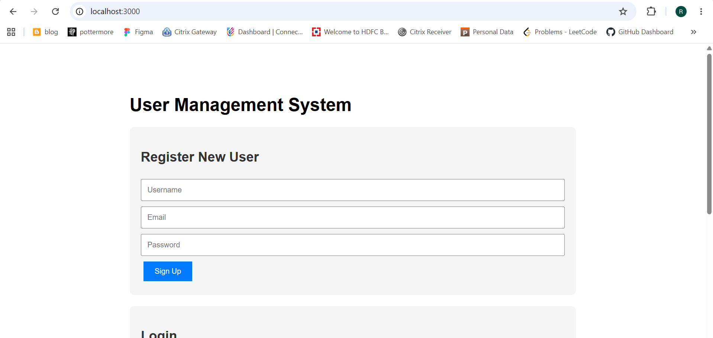

# 🍃 Experiment 13 — MongoDB & Mongoose with Node.js

A practical backend development experiment demonstrating how to connect a **Node.js application with MongoDB using Mongoose**, define structured data using schemas and models, and perform database operations for persistent data storage.

This experiment introduces **NoSQL database integration** and demonstrates how Mongoose acts as an **Object Data Modeling (ODM)** layer between a Node.js application and MongoDB.

---

## 📌 Experiment

**Experiment 13: Database Integration using MongoDB & Mongoose**

### Technologies Used


---

# 🎯 Objective

The objective of this experiment is to understand how a backend application can communicate with a **MongoDB database using Mongoose**.

The experiment focuses on:

- Connecting Node.js with MongoDB
- Understanding NoSQL databases
- Using Mongoose as an ODM
- Creating Mongoose schemas
- Creating models from schemas
- Storing documents in MongoDB
- Retrieving stored information
- Searching for users
- Updating database records
- Deleting database records
- Working with asynchronous database operations
- Handling database errors

---

# 🧠 What is MongoDB?

**MongoDB** is a NoSQL document-oriented database.

Unlike relational databases, where information is stored in tables and rows, MongoDB stores information as **documents inside collections**.

```text
MongoDB
   │
   ▼
Database
   │
   ▼
Collection
   │
   ▼
Documents
```

A typical MongoDB document may look like:

```javascript
{
    name: "Riya Sharma",
    email: "riya@example.com",
    age: 21
}
```

MongoDB's document-oriented structure makes it well suited for JavaScript and Node.js applications.

---

# 🔗 What is Mongoose?

**Mongoose** is an Object Data Modeling library for **Node.js and MongoDB**.

It provides a structured layer between the Node.js application and MongoDB.

```text
Node.js Application
        │
        ▼
     Mongoose
        │
        ▼
      Schema
        │
        ▼
      Model
        │
        ▼
     MongoDB
```

Mongoose provides features such as:

- Schemas
- Models
- Validation
- Queries
- Data type definitions
- Database operations
- Error handling

A Mongoose **model** is created from a schema and is then used to interact with MongoDB documents.

---

# 🏗️ Application Architecture

The application follows a simple backend/database architecture:

```text
                   USER
                     │
                     ▼
              HTTP Request
                     │
                     ▼
            ┌────────────────┐
            │   Express.js   │
            │     Server     │
            └───────┬────────┘
                    │
                    ▼
            Application Logic
                    │
                    ▼
            ┌────────────────┐
            │    Mongoose    │
            │      ODM       │
            └───────┬────────┘
                    │
                    ▼
            ┌────────────────┐
            │    MongoDB     │
            │    Database    │
            └────────────────┘
```

---

# 🔌 Connecting to MongoDB

Mongoose provides the connection between the Node.js application and MongoDB.

The basic connection process follows:

```javascript
mongoose.connect("mongodb://127.0.0.1:27017/database_name")
    .then(() => {
        console.log("MongoDB connected");
    })
    .catch((error) => {
        console.log(error);
    });
```

The application must establish the MongoDB connection before database operations can be performed.

---

# 📐 Mongoose Schema

A **schema** defines the expected structure of documents stored in MongoDB.

For example:

```javascript
const userSchema = new mongoose.Schema({
    name: String,
    email: String,
    age: Number
});
```

This establishes the structure of a user document.

```text
User
│
├── name
├── email
└── age
```

Schemas make application data more structured and predictable.

---

# 🧩 Mongoose Model

A model is created from the schema:

```javascript
const User = mongoose.model("User", userSchema);
```

The model provides the interface through which the application communicates with the MongoDB collection.

```text
Schema
   │
   ▼
 Model
   │
   ▼
MongoDB Collection
```

The model can then perform operations such as:

```text
Create
Read
Update
Delete
```

---

# ➕ Create — Adding Data

New documents can be created using a Mongoose model.

Example:

```javascript
const user = new User({
    name: "Riya Sharma",
    email: "riya@example.com",
    age: 21
});

await user.save();
```

### Flow

```text
User Data
    │
    ▼
Mongoose Model
    │
    ▼
Schema Validation
    │
    ▼
MongoDB
    │
    ▼
Document Stored
```

The data remains available even after the Node.js application is restarted because it is stored persistently in MongoDB.

---

# 🔍 Read — Retrieving Data

Mongoose provides query methods for retrieving stored documents.

For example:

```javascript
const users = await User.find();
```

Individual records can also be searched using specific conditions.

```javascript
const user = await User.findOne({
    email: "riya@example.com"
});
```

The model performs the query and converts the MongoDB result into JavaScript objects that can be used by the application.

---

# ✏️ Update — Modifying Data

Existing documents can be modified using Mongoose update operations.

Conceptually:

```text
Find Document
      │
      ▼
Modify Fields
      │
      ▼
Update MongoDB
      │
      ▼
Updated Document
```

This allows information to be changed without recreating the complete document.

---

# 🗑️ Delete — Removing Data

Documents that are no longer required can be removed from the database.

```text
Find Document
      │
      ▼
Delete Operation
      │
      ▼
MongoDB
      │
      ▼
Document Removed
```

Together, these operations form the basic **CRUD lifecycle**.

---

# 🔄 CRUD Operations

CRUD represents the four fundamental operations used when working with persistent data:

| Operation | Meaning | Purpose |
|---|---|---|
| **C** | Create | Insert new information |
| **R** | Read | Retrieve existing information |
| **U** | Update | Modify stored information |
| **D** | Delete | Remove information |

Mongoose models provide methods such as `find()`, `findOne()`, update methods, and deletion methods for working with MongoDB documents.

---

# ⚡ Asynchronous Database Operations

Database operations do not complete instantly.

The application therefore uses asynchronous JavaScript patterns such as:

```javascript
async function getUsers() {
    const users = await User.find();
    return users;
}
```

Using `async/await` makes asynchronous database operations easier to read and manage.

### Execution Flow

```text
Request Database Operation
          │
          ▼
       await
          │
          ▼
 MongoDB Processes Query
          │
          ▼
    Result Returned
          │
          ▼
 Continue Execution
```

---

# 🛡️ Error Handling

Database operations may fail because of issues such as:

- MongoDB server not running
- Invalid database connection
- Invalid data
- Duplicate values
- Query errors

The application can handle such errors using `try...catch`:

```javascript
try {
    const users = await User.find();
} catch (error) {
    console.error(error);
}
```

Proper error handling prevents unexpected failures from crashing the application without explanation.

---

# 📁 Project Structure

```text
mongoose-demo/
│
├── server.js
│   ├── Express server
│   ├── MongoDB connection
│   ├── Mongoose schema
│   ├── Mongoose model
│   └── Database operations
│
├── package.json
├── package-lock.json
│
├── Images/
│   └── screenshot.png
│
└── README.md
```

> If your main JavaScript filename differs, keep the actual filename from your repository in this structure.

---

# 🛠️ Technology Stack

| Technology | Purpose |
|---|---|
| **Node.js** | Executes JavaScript on the server |
| **Express.js** | Handles backend HTTP requests and routes |
| **MongoDB** | Stores application data persistently |
| **Mongoose** | Provides schemas, models and MongoDB operations |
| **JavaScript** | Implements backend application logic |
| **npm** | Manages Node.js dependencies |

---

# 🔄 Complete Data Flow

```text
                  Client
                    │
                    ▼
              HTTP Request
                    │
                    ▼
              Express.js
                    │
                    ▼
            Application Logic
                    │
                    ▼
             Mongoose Model
                    │
                    ▼
             Mongoose Schema
                    │
                    ▼
                 MongoDB
                    │
             ┌──────┴──────┐
             │             │
             ▼             ▼
         Collection     Document
             │
             ▼
        Query Result
             │
             ▼
         Express.js
             │
             ▼
       HTTP Response
```

---

# 🚀 Installation & Setup

## Prerequisites

Make sure the following are installed:

- **Node.js**
- **npm**
- **MongoDB**

Check Node.js and npm:

```bash
node --version
npm --version
```

---

## 1️⃣ Clone the Repository

```bash
git clone https://github.com/ritkritig/BackendDevelopment.git
```

Navigate to the project:

```bash
cd "BackendDevelopment/Backend Lab/Experiment13/mongoose-demo"
```

---

## 2️⃣ Install Dependencies

Run:

```bash
npm install
```

This installs the packages listed in `package.json`.

---

## 3️⃣ Start MongoDB

Make sure your local MongoDB service is running before starting the application.

A typical local MongoDB connection uses:

```text
mongodb://127.0.0.1:27017
```

---

## 4️⃣ Run the Application

If the main file is `server.js`:

```bash
node server.js
```

If a start script is defined in `package.json`, you can instead use:

```bash
npm start
```

---

# 📸 Final Output

The final implementation demonstrates successful integration between a **Node.js backend and MongoDB using Mongoose**, allowing application data to be stored, retrieved and managed persistently.

<p align="center">
  
</p>

<p align="center">
  <i>Final output of the MongoDB and Mongoose database integration experiment.</i>
</p>

---

# 🧠 Concepts Practiced

This experiment provides practical experience with:

- NoSQL databases
- MongoDB
- MongoDB collections
- MongoDB documents
- Node.js database connectivity
- Mongoose ODM
- Mongoose schemas
- Mongoose models
- Persistent storage
- CRUD operations
- Database queries
- Asynchronous programming
- `async/await`
- Promises
- Database error handling
- Backend-database integration

---

# 🎓 Learning Outcomes

After completing this experiment, I was able to:

- Understand the role of databases in backend applications
- Differentiate document-based storage from relational storage
- Connect a Node.js application to MongoDB
- Use Mongoose to interact with MongoDB
- Define structured data using Mongoose schemas
- Create models from schemas
- Insert documents into MongoDB
- Retrieve stored documents
- Modify existing information
- Delete database records
- Work with asynchronous database operations
- Handle database errors
- Understand how persistent storage integrates with backend applications

---

## 📚 Course Information

**Course:** Backend Development Lab  
**Experiment:** 13  
**Topic:** MongoDB & Mongoose  
**Focus:** NoSQL Database Integration and Object Data Modeling

---

## 👩‍💻 Author

**Ritkriti Goyal**

Backend Development Lab — Experiment 13
