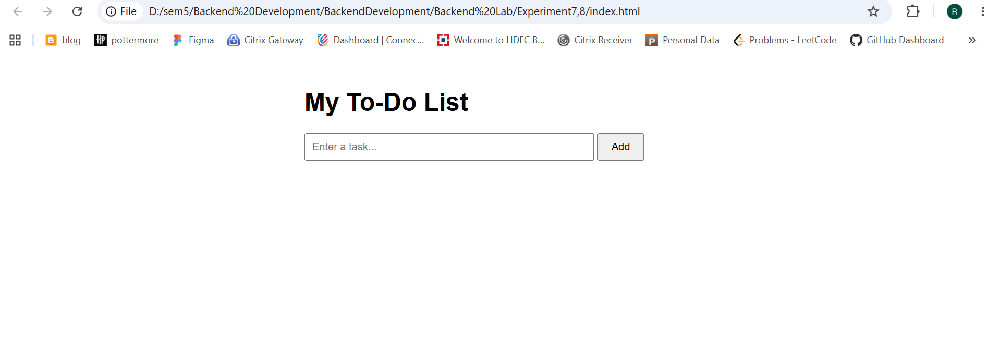

# ✅ Experiment 7 & 8 — ES6 JavaScript To-Do Application

A lightweight and interactive **To-Do List application** built using **HTML5 and modern JavaScript (ES6)** as part of the Backend Development Lab.

The experiment demonstrates how modern JavaScript features can be combined with **DOM manipulation and event handling** to create a dynamic browser-based application without requiring a backend server or external framework.

---

## 📌 Experiment

**Experiment 7 & 8: Modern JavaScript (ES6) & DOM Manipulation**

### Technologies Used


---

# 🎯 Objective

The objective of this experiment is to understand and practically implement important **ES6 JavaScript concepts** while creating an interactive To-Do application.

The experiment demonstrates:

- ES6 classes
- Arrow functions
- Spread operator
- Object destructuring
- Array `forEach()`
- Array `map()`
- Array `filter()`
- DOM manipulation
- Dynamic element creation
- Event listeners
- Keyboard events
- Event delegation
- Application state management

---

# 💡 Project Overview

The **ES6 To-Do Application** allows users to maintain a temporary list of tasks directly in the browser.

Users can:

- ➕ Add new tasks
- ⌨️ Add tasks using the Enter key
- 📋 View dynamically generated tasks
- ✅ Mark tasks as completed
- 🔄 Mark completed tasks as incomplete again
- 🗑️ Delete tasks

The application stores its current state in a JavaScript array and dynamically updates the webpage whenever that state changes.

---

# ✨ Features

## ➕ 1. Add New Tasks

Users can enter a task into the input field and click the **Add** button.

The application first removes unnecessary whitespace:

```javascript
const title = input.value.trim();
```

Empty tasks are ignored:

```javascript
if (!title) return;
```

A valid task is then added to the application state.

---

# ⌨️ 2. Add Tasks with Enter

Tasks can also be added by pressing the **Enter** key.

```javascript
input.addEventListener("keydown", (e) => {
    if (e.key === "Enter") addTask();
});
```

This improves usability by allowing tasks to be added without clicking the button every time.

---

# 🧩 3. ES6 Task Class

Each task is represented using an ES6 `Task` class:

```javascript
class Task {
    constructor(title) {
        this.id = Date.now();
        this.title = title;
        this.completed = false;
    }
}
```

Every task contains:

```text
Task
│
├── id
├── title
└── completed
```

### `id`

Generated using:

```javascript
Date.now()
```

and used to uniquely identify the task.

### `title`

Stores the text entered by the user.

### `completed`

Stores whether the task has been completed.

New tasks begin with:

```javascript
completed = false
```

---

# 🗃️ 4. Application State

Tasks are maintained in a JavaScript array:

```javascript
let tasks = [];
```

The array represents the application's current state.

```text
tasks
  │
  ├── Task 1
  ├── Task 2
  ├── Task 3
  └── ...
```

Whenever a task is added, deleted or updated, the array changes and the interface is rendered again.

---

# ⚡ 5. Spread Operator

New tasks are added using the ES6 spread operator:

```javascript
tasks = [...tasks, new Task(title)];
```

Instead of directly modifying the existing array, this creates a new array containing:

```text
Existing Tasks
      +
   New Task
      ↓
Updated tasks Array
```

This demonstrates immutable-style state updates.

---

# 🎨 6. Dynamic DOM Rendering

The task list is not hard-coded in HTML.

Instead, JavaScript dynamically generates the interface using:

```javascript
document.createElement()
```

For each task, the application creates:

```text
<li>
 │
 ├── <span> Task Title
 │
 └── <button> Delete
```

The elements are then inserted into the webpage.

---

# 🔄 7. Render Function

The `renderTasks()` function keeps the webpage synchronized with the current task array.

```javascript
const renderTasks = () => {
    list.innerHTML = "";

    tasks.forEach(({ id, title, completed }) => {
        // Create and display task
    });
};
```

The rendering process is:

```text
tasks Array
     │
     ▼
renderTasks()
     │
     ▼
Clear Existing List
     │
     ▼
Loop Through Tasks
     │
     ▼
Create DOM Elements
     │
     ▼
Display Updated List
```

---

# 📦 8. Object Destructuring

Inside `forEach()`, task properties are extracted using ES6 object destructuring:

```javascript
tasks.forEach(({ id, title, completed }) => {
```

Instead of repeatedly writing:

```javascript
task.id
task.title
task.completed
```

the required properties can be accessed directly as:

```text
id
title
completed
```

---

# 🔁 9. `forEach()`

The application uses:

```javascript
tasks.forEach(...)
```

to iterate over every task when rendering the interface.

Each task is converted into corresponding HTML elements and inserted into the list.

---

# ✅ 10. Toggle Task Completion

Clicking a task toggles its completion status.

The application uses `map()`:

```javascript
tasks = tasks.map(t =>
    t.id === id
        ? { ...t, completed: !t.completed }
        : t
);
```

This changes:

```text
completed = false
        ↓
completed = true
```

and clicking again reverses it:

```text
completed = true
        ↓
completed = false
```

---

# 🗺️ 11. Array `map()`

`map()` is used because the application needs to produce an updated version of the task array.

```text
Original tasks Array
        │
        ▼
      map()
        │
        ▼
Find Matching Task
        │
        ▼
Toggle completed
        │
        ▼
New tasks Array
```

Tasks that do not match the selected ID remain unchanged.

---

# 🎨 12. Completed Task Styling

When a task is completed, the application adds:

```javascript
span.classList.add("done");
```

The `.done` CSS class applies:

```css
.done {
    text-decoration: line-through;
    color: gray;
}
```

Therefore, completed tasks are displayed with a **strikethrough and gray text**.

---

# 🗑️ 13. Delete Tasks

Each task contains a **Delete** button.

When clicked, the application removes the corresponding task using:

```javascript
tasks = tasks.filter(t => t.id !== id);
```

The updated task list is then rendered again.

---

# 🔍 14. Array `filter()`

The `filter()` method creates a new array containing every task except the selected task.

```text
Tasks
  │
  ├── Task 1
  ├── Task 2  ← Delete
  └── Task 3
        │
        ▼
      filter()
        │
        ▼
Tasks
  │
  ├── Task 1
  └── Task 3
```

---

# 🎯 15. Event Delegation

Instead of attaching separate event listeners to every task, the application attaches one listener to the entire task list:

```javascript
list.addEventListener("click", (event) => {
```

The clicked list item is located using:

```javascript
const li = event.target.closest("li");
```

The task ID is then retrieved from:

```javascript
li.dataset.id
```

This is an example of **event delegation**.

---

# 🧠 How Click Handling Works

The same event listener handles both **deleting** and **toggling** tasks.

```text
User Clicks Task List
        │
        ▼
Find Closest <li>
        │
        ▼
Retrieve Task ID
        │
        ▼
Is Delete Button?
        │
    ┌───┴────┐
    │        │
   YES       NO
    │        │
    ▼        ▼
 filter()   map()
    │        │
 Delete    Toggle
    │        │
    └───┬────┘
        ▼
 renderTasks()
```

---

# 🔄 Complete Application Workflow

```text
                 Open Application
                        │
                        ▼
                  Enter a Task
                        │
                ┌───────┴────────┐
                │                │
             Click Add       Press Enter
                │                │
                └───────┬────────┘
                        ▼
                    addTask()
                        │
                        ▼
                 Validate Input
                        │
                        ▼
               Create Task Object
                        │
                        ▼
                Add to tasks[]
                        │
                        ▼
                  renderTasks()
                        │
                        ▼
                 Display Task
                        │
              ┌─────────┴─────────┐
              │                   │
              ▼                   ▼
          Click Task         Click Delete
              │                   │
              ▼                   ▼
            map()              filter()
              │                   │
              ▼                   ▼
      Toggle Completion       Remove Task
              │                   │
              └─────────┬─────────┘
                        ▼
                  renderTasks()
```

---

# 📁 Project Structure

```text
Experiment7,8/
│
├── index.html
│   ├── Application interface
│   ├── Input field
│   ├── Add button
│   ├── Task list
│   └── CSS styling
│
├── app.js
│   ├── Task state
│   ├── Task class
│   ├── Rendering logic
│   ├── Add-task logic
│   ├── Completion toggle
│   ├── Delete functionality
│   └── Event handling
│
├── Images/
│   └── screenshot.png
│
└── README.md
```

---

# 🛠️ Technologies Used

| Technology | Purpose |
|---|---|
| **HTML5** | Application structure |
| **CSS3** | Basic interface styling |
| **JavaScript ES6** | Application logic |
| **DOM API** | Dynamic webpage manipulation |
| **VS Code** | Development environment |
| **Browser** | Running and testing the application |

No external JavaScript framework or library is required.

---

# 🚀 How to Run

Because this is a client-side JavaScript application, no Node.js server or database is required.

### Method 1 — Open Directly

Open:

```text
index.html
```

in a modern web browser.

### Method 2 — VS Code Live Server

1. Open the `Experiment7,8` folder in VS Code.
2. Right-click `index.html`.
3. Select **Open with Live Server**.
4. The Todo application will open in your browser.

---

# 📸 Final Output

The final application provides a simple interactive Todo interface where users can **add, complete, redo and delete tasks dynamically using modern JavaScript**.

<p align="center">
  
</p>

<p align="center">
  <i>Final output of the ES6 JavaScript To-Do Application.</i>
</p>

---

# 🧠 ES6 Concepts Demonstrated

| ES6 / JavaScript Concept | Usage in Application |
|---|---|
| **Class** | Represents individual Task objects |
| **Arrow Functions** | Used for application functions and callbacks |
| **Spread Operator** | Adds tasks and updates task objects |
| **Destructuring** | Extracts task properties during rendering |
| **`forEach()`** | Renders each task |
| **`map()`** | Updates completion status |
| **`filter()`** | Deletes tasks |
| **Template State** | Maintains tasks in an array |
| **Event Listeners** | Handles user interactions |
| **Event Delegation** | Handles task and delete clicks efficiently |
| **DOM Manipulation** | Creates and updates interface elements dynamically |

---

# 🎓 Learning Outcomes

After completing this experiment, I was able to:

- Understand and use modern ES6 JavaScript syntax
- Create JavaScript classes and objects
- Maintain application state using arrays
- Use the spread operator for state updates
- Apply object destructuring
- Work with `forEach()`, `map()` and `filter()`
- Dynamically create HTML elements using JavaScript
- Manipulate the DOM
- Handle button and keyboard events
- Implement event delegation
- Add and delete tasks dynamically
- Toggle task completion state
- Synchronize application state with the user interface

---

## 📚 Course Information

**Course:** Backend Development Lab  
**Experiment:** 7 & 8  
**Project:** ES6 To-Do Application  
**Topic:** Modern JavaScript & DOM Manipulation  
**Focus:** ES6 Features, Array Methods and Event Handling

---

## 👩‍💻 Author

**Ritkriti Goyal**

Backend Development Lab — Experiment 7 & 8
